Estudiante : Andrés Madrigal
## Spec

//El usuario genera un dato para su transaccion y este pasa 
por varias capas hasta llegar a la implementacion especifica del procesador para luego ser aplicados los cambios en la base de datos.

### documentos:
#### IdentityType (enum)
+ NACIONAL
+ TAX
+ PASAPORTE


#### Identificacion (Abstract)
- tipo : IdentityType
- nombreDelDueño : String
- numeroId : String
+ Identificacion(tipo : IdentityType, nombreDelDueño : String, numeroId : String)
//Elementos como el ID y el nombre son reusados segun el documento especifico necesite

#### IdNacional (extends Identificacion)
- fechaNacimiento : Date 
#### IdImpuesto (extends Identificacion)
//El sistema no necesita más informacion
#### Pasaporte
- fechaNacimiento : Date 
- nacionalidad : String
- fechaDeExpedicion : Date
- fechaCaducidad : Date
+ esValido() : boolean
#### Residencia
- pais : String
- fechaCaducidad : Date
+ Residencia(pais : String, fechaCaducidad : Date)
+ estaVigente() : boolean


### operaciones

#### TipoOperacion (enum)
+ DEPOSIT
+ WITHDRAWAL
+ DOMESTIC_TRANSFER
+ INTERNATIONAL_TRANSFER
+ PAYROLL

#### Resultado 
- msg : String
- exito : boolean
- tarifa : double
- objetoOriginal : Object
- resultado : InformacionOperacion

//Se guarda el objeto original en caso de que se ocupe para algun otro proceso

#### InformacionOperacion
- id : String
- tipo : TipoOperacion
- cuentaOrigen : String
- monto : double
- tarifas : double
- moneda : String

// Guarda todos los datos que son necesarios para ejecutar y luego guardar la operación una vez fue terminada

// La mayoria de los datos queda como null para ser rellenados despues al terminar la transaccion 

#### InfoTransaccionNacional (extends InformacionOperacion)
- numeroDestinoCuenta : String
 
#### InfoTransaccionInternacional (extends InformacionOperacion)
- numeroDestinoBic : String

#### InfoTransaccionNegocios (extends InformacionOperacion)
- codigoAprovacion : String
- numeroDestinoCuenta : String
- cuentasPayroll : List\<String>

#### Depositar (Interface)
+ depositar(info : InformacionOperacion, procesador : Procesador) : Resultado
#### Withdraw (Interface)
+ withdraw(info : InformacionOperacion, procesador : Procesador) : Resultado
#### DomesticTransfer (Interface)
+ domesticTransfer(info : InformacionOperacion, procesador : Procesador) : Resultado
#### InternationalTransfer (Interface)
+ internationalTransfer(info : InformacionOperacion, procesador : Procesador) : Resultado
#### Payroll (Interface)
+ PayRoll(info : InformacionOperacion, procesador : Procesador) : Resultado

//Funcionan como interfaces para implementar el codigo y demás necesario despues de realizar las operaciones en el procesador

### Cuentas
#### Cuenta (Abstract, implements Depositar, Withdraw)
- identificacion : Identificacion
- limite : double
- listaOperaciones : ArrayList\<Operaciones>
- numeroCuenta : String
+ Cuenta (id : Identificacion, limite : double) 
+ ejecutarOperacion(info : InformacionOperacion) : Resultado
+ depositar(info : InformacionOperacion, procesador : Procesador) : Resultado
+ withdraw(info : InformacionOperacion, procesador : Procesador) : Resultado
+ verificacionDeLimite(info : InformacionOperacion) : boolean

//Las cuentas hace sus verificaciones para poder revisar si esta es valida.

#### Personal (extends Cuenta, implements DomesticTransfer)
+ depositar(info : InformacionOperacion, procesador : Procesador) : Resultado
+ withdraw(info : InformacionOperacion, procesador : Procesador) : Resultado
+ domesticTransfer(info : InformacionOperacion, procesador : Procesador) : Resultado

#### Negocio (extends Cuenta, implements DomesticTransfer, InternationalTransfer, Payroll)
+ depositar(info : InformacionOperacion, procesador : Procesador) : Resultado
+ withdraw(info : InformacionOperacion, procesador : Procesador) : Resultado
+ domesticTransfer(info : InformacionOperacion, procesador : Procesador) : Resultado
+ internationalTransfer(info : InformacionOperacion, procesador : Procesador) : Resultado
+ PayRoll(info : InformacionOperacion, procesador : Procesador) : Resultado

#### Menor (extends Cuenta)
- identificacionGuardian : Identificacion
+ verificacionGuaridan() : boolean
+ depositar(info : InformacionOperacion, procesador : Procesador) : Resultado
+ withdraw(info : InformacionOperacion, procesador : Procesador) : Resultado

#### Extranjero (extends Cuenta, implements DomesticTransfer, InternationalTransfer)
- documentoResidencia : Residencia
+ depositar(info : InformacionOperacion, procesador : Procesador) : Resultado
+ withdraw(info : InformacionOperacion, procesador : Procesador) : Resultado
+ domesticTransfer(info : InformacionOperacion, procesador : Procesador) : Resultado
+ internationalTransfer(info : InformacionOperacion, procesador : Procesador) : Resultado


### procesadores

#### TipoProcesador 
+ NATIONAL_BANK
+ PACIFIC_BANK
+ SWIFT_GATEWAY

#### Procesador (abstract)
- tipo : TipoProcesador
- listaOperaciones : ArrayList\<Operaciones>
+ PermiteOperacion(TipoOperacion) : boolean
+ RealizarOperacion(info : InformacionOperacion) : Resultado
+ calcularTarifa(monto : double) : double

#### NationalBank
+ RealizarOperacion(info : InformacionOperacion) : Resultado
+ calcularTarifa(monto : double) : double
#### Pacific Bank
+ RealizarOperacion(info : InformacionOperacion) : Resultado
+ calcularTarifa(monto : double) : doubleo

#### SwiftGateway
+ RealizarOperacion(info : InformacionOperacion) : Resultado
+ calcularTarifa(monto : double) : double

//Wrappers que manejan lo interno del procesador, reciben datos del sistema para luego interpretarlos para el procesador y de volverlos con el formato correspondiente al sistema. Con tal de que no importen cambios en el procesador a otras partes del codigo.

### servicioBanco
#### Banco
- cuentas : Map\<String, Cuenta>
- operacionesAnteriores : Map\<String, InformacionOperacion>
+ obtenerDatosYEjecutar(operacion InformacionOperacion) : boolean
- guardarInformacionOperacion(operacion InformacionOperacion) : boolean
+ obtenerDatosOperacion()
 
//El banco solo se encarga de pasarle a la cuenta la operacion y guardarla si fue exitos / mostrar el error.

## Usos de polimorfismo:
En las clases de Cuenta podemos ver un ejemplo de polimorfismo, en la forma de como se implementa.

Usemos como ejemplo el metodo depositar, el cual se puede comenzar a construir con una base en el super:

```
public abstract class Cuenta implements Depositar, Withdraw {
    /*Codigo*/

    @Override
    public Resultado depositar(InformacionOperacion info, Procesador procesador) {
        if(!Procesador.PermiteOperacion(info.getTipo()))  
        {
            //Retorna un resultado con mensaje de error
        }
        Return RealizarOperacion(info);
        //Mas codigo relacionado
    }
    /*Codigo*/
}

```
Cuentas basicas como la cuenta personal problemente puedan utilizarla sin mayor problema como super; o simplemente no se le hace Override.
```
public class Personal extends Cuenta implements DomesticTransfer {
    /*Codigo*/

    @Override
    public Resultado depositar(InformacionOperacion info, Procesador procesador) {
        Resultado resultado = super.depositar(info, procesador);
        // Algun cambio en los resultados si es necesario
        return(resultado);
    }
    /*Codigo*/
}
```
Mientras que clases más complejas como Extranjero donde hay que hacer una verificacion se pueden ver así:
```
public class Personal extends Cuenta implements DomesticTransfer, InternationalTransfer {
    /*Codigo*/
    @Override
    public Resultado depositar(InformacionOperacion info, Procesador procesador) {
        if (this.documentoResidencia.estaVigente()) {
            Resultado resultado = super.depositar(info, procesador);
            // Algun cambio en los resultados si es necesario
            return(resultado);
        }
        else {
            //Creamos un mensaje en resultado de error indicando que la cuenta ya no se puede usar
        }
    }
    /*Codigo*/
}
```
Otro ejemplo son los procesadores, no conocemos exactamente como se utilizan. Como funciona exactamente la Api de ninguno de ellos y pueden utilizar objetos totalmente imcompatibles.

Digamos que el NacionalBank funciona por alguna razon de forma local y se pasan por atributos, mientras que con PacificBank es por red.
```
public class NationalBank extends Procesador {
    private NationalBankApi api; 
    @Override
    public Resultado RealizarOperacion(InformacionOperacion info) {
        String ref = api.postTransaction(/*Todos los datos como atributos*/);
        //Manejo del resultado
    }

    @Override
    public double calcularTarifa(double monto) { return 0; } // gratis
}

public class PacificBank extends Procesador {
    private PacificBankApi api; 
    @Override
    public Resultado RealizarOperacion(InformacionOperacion info) {
        // Traduce al formato de Pacific: monto en centavos
        long centavos = Math.round(info.getMonto() * 100);

        // Convierte los datos un objeto que permite usar la api y sea serializable
        // Lo manda por la red
        // van dentro de api.send(...)
        String respuesta = api.send(/* datos de info */);

        //Manejo del resultado
    }
}
```

## Diagrama:

```mermaid
classDiagram
    direction TB

    %% ===================== DOCUMENTOS =====================
    class IdentityType {
        <<enumeration>>
        + NACIONAL
        + TAX
        + PASAPORTE
    }

    class Identificacion {
        <<abstract>>
        - tipo : IdentityType
        - nombreDelDueño : String
        - numeroId : String
        + Identificacion(tipo : IdentityType#44; nombreDelDueño : String#44; numeroId : String)
    }

    class IdNacional {
        - fechaNacimiento : Date
    }

    class IdImpuesto {
    }

    class Pasaporte {
        - fechaNacimiento : Date
        - nacionalidad : String
        - fechaDeExpedicion : Date
        - fechaCaducidad : Date
        + esValido() : boolean
    }

    class Residencia {
        - pais : String
        - fechaCaducidad : Date
        + Residencia(pais : String#44; fechaCaducidad : Date)
        + estaVigente() : booleam
    }

    Identificacion --> IdentityType
    IdNacional --|> Identificacion
    IdImpuesto --|> Identificacion

    %% ===================== OPERACIONES =====================
    class TipoOperacion {
        <<enumeration>>
        + DEPOSIT
        + WITHDRAWAL
        + DOMESTIC_TRANSFER
        + INTERNATIONAL_TRANSFER
        + PAYROLL
    }

    class Resultado {
        - msg : String
        - exito : boolean
        - tarifa : double
        - objetoOriginal : Object
        - resultado : InformacionOperacion
    }

    class InformacionOperacion {
        - id : String
        - tipo : TipoOperacion
        - cuentaOrigen : String
        - monto : double
        - tarifas : double
        - moneda : String
    }

    class InfoTransaccionNacional {
        - numeroDestinoCuenta : String
    }

    class InfoTransaccionInternacional {
        - numeroDestinoBic : String
    }

    class InfoTransaccionNegocios {
        - codigoAprovacion : String
        - numeroDestinoCuenta : String
        - cuentasPayroll : List~String~
    }

    InfoTransaccionNacional --|> InformacionOperacion
    InfoTransaccionInternacional --|> InformacionOperacion
    InfoTransaccionNegocios --|> InformacionOperacion
    InformacionOperacion --> TipoOperacion
    Resultado --> InformacionOperacion

    %% ===================== INTERFACES =====================
    class Depositar {
        <<interface>>
        + depositar(info : InformacionOperacion#44; procesador : Procesador) : Resultado
    }

    class Withdraw {
        <<interface>>
        + withdraw(info : InformacionOperacion#44; procesador : Procesador) : Resultado
    }

    class DomesticTransfer {
        <<interface>>
        + domesticTransfer(info : InformacionOperacion#44; procesador : Procesador) : Resultado
    }

    class InternationalTransfer {
        <<interface>>
        + internationalTransfer(info : InformacionOperacion#44; procesador : Procesador) : Resultado
    }

    class Payroll {
        <<interface>>
        + PayRoll(info : InformacionOperacion#44; procesador : Procesador) : Resultado
    }

    %% ===================== CUENTAS =====================
    class Cuenta {
        <<abstract>>
        - identificacion : Identificacion
        - limite : double
        - listaOperaciones : ArrayList~Operaciones~
        - numeroCuenta : String
        + Cuenta(id : Identificacion#44; limite : double)
        + ejecutarOperacion(info : InformacionOperacion) : Resultado
        + depositar(info : InformacionOperacion#44; procesador : Procesador) : Resultado
        + withdraw(info : InformacionOperacion#44; procesador : Procesador) : Resultado
        + verificacionDeLimite(info : InformacionOperacion) : boolean
    }

    class Personal {
        + depositar(info : InformacionOperacion#44; procesador : Procesador) : Resultado
        + withdraw(info : InformacionOperacion#44; procesador : Procesador) : Resultado
        + domesticTransfer(info : InformacionOperacion#44; procesador : Procesador) : Resultado
    }

    class Negocio {
        + depositar(info : InformacionOperacion#44; procesador : Procesador) : Resultado
        + withdraw(info : InformacionOperacion#44; procesador : Procesador) : Resultado
        + domesticTransfer(info : InformacionOperacion#44; procesador : Procesador) : Resultado
        + internationalTransfer(info : InformacionOperacion#44; procesador : Procesador) : Resultado
        + PayRoll(info : InformacionOperacion#44; procesador : Procesador) : Resultado
    }

    class Menor {
        - identificacionGuardian : Identificacion
        + verificacionGuaridan() : boolean
        + depositar(info : InformacionOperacion#44; procesador : Procesador) : Resultado
        + withdraw(info : InformacionOperacion#44; procesador : Procesador) : Resultado
    }

    class Extranjero {
        - documentoResidencia : Residencia
        + depositar(info : InformacionOperacion#44; procesador : Procesador) : Resultado
        + withdraw(info : InformacionOperacion#44; procesador : Procesador) : Resultado
        + domesticTransfer(info : InformacionOperacion#44; procesador : Procesador) : Resultado
        + internationalTransfer(info : InformacionOperacion#44; procesador : Procesador) : Resultado
    }

    Cuenta ..|> Depositar
    Cuenta ..|> Withdraw
    Personal --|> Cuenta
    Negocio --|> Cuenta
    Menor --|> Cuenta
    Extranjero --|> Cuenta

    Personal ..|> DomesticTransfer
    Negocio ..|> DomesticTransfer
    Negocio ..|> InternationalTransfer
    Negocio ..|> Payroll
    Extranjero ..|> DomesticTransfer
    Extranjero ..|> InternationalTransfer

    Cuenta --> Identificacion
    Cuenta --> InformacionOperacion : listaOperaciones
    Menor --> Identificacion : identificacionGuardian
    Extranjero --> Residencia : documentoResidencia

    %% ===================== PROCESADORES =====================
    class TipoProcesador {
        <<enumeration>>
        + NATIONAL_BANK
        + PACIFIC_BANK
        + SWIFT_GATEWAY
    }

    class Procesador {
        <<abstract>>
        - tipo : TipoProcesador
        - listaOperaciones : ArrayList~Operaciones~
        + PermiteOperacion(TipoOperacion) : boolean
        + RealizarOperacion(info : InformacionOperacion) : Resultado
        + calcularTarifa(monto : double) : double
    }

    class NationalBank {
        + RealizarOperacion(info : InformacionOperacion) : Resultado
        + calcularTarifa(monto : double) : double
    }

    class PacificBank {
        + RealizarOperacion(info : InformacionOperacion) : Resultado
        + calcularTarifa(monto : double) : doubleo
    }

    class SwiftGateway {
        + RealizarOperacion(info : InformacionOperacion) : Resultado
        + calcularTarifa(monto : double) : double
    }

    NationalBank --|> Procesador
    PacificBank --|> Procesador
    SwiftGateway --|> Procesador
    Procesador --> TipoProcesador

    %% ===================== SERVICIO BANCO =====================
    class Banco {
        - cuentas : Map~String#44; Cuenta~
        - operacionesAnteriores : Map~String#44; InformacionOperacion~
        + obtenerDatosYEjecutar(operacion InformacionOperacion) : boolean
        - guardarInformacionOperacion(operacion InformacionOperacion) : boolean
        + obtenerDatosOperacion()
    }

    Banco o-- Cuenta : cuentas
    Banco o-- InformacionOperacion : operacionesAnteriores

    %% ===================== DEPENDENCIAS ENTRE CAPAS =====================
    Depositar ..> Procesador
    Withdraw ..> Procesador
    DomesticTransfer ..> Procesador
    InternationalTransfer ..> Procesador
    Payroll ..> Procesador
    Procesador ..> Resultado
    Cuenta ..> Resultado
```

